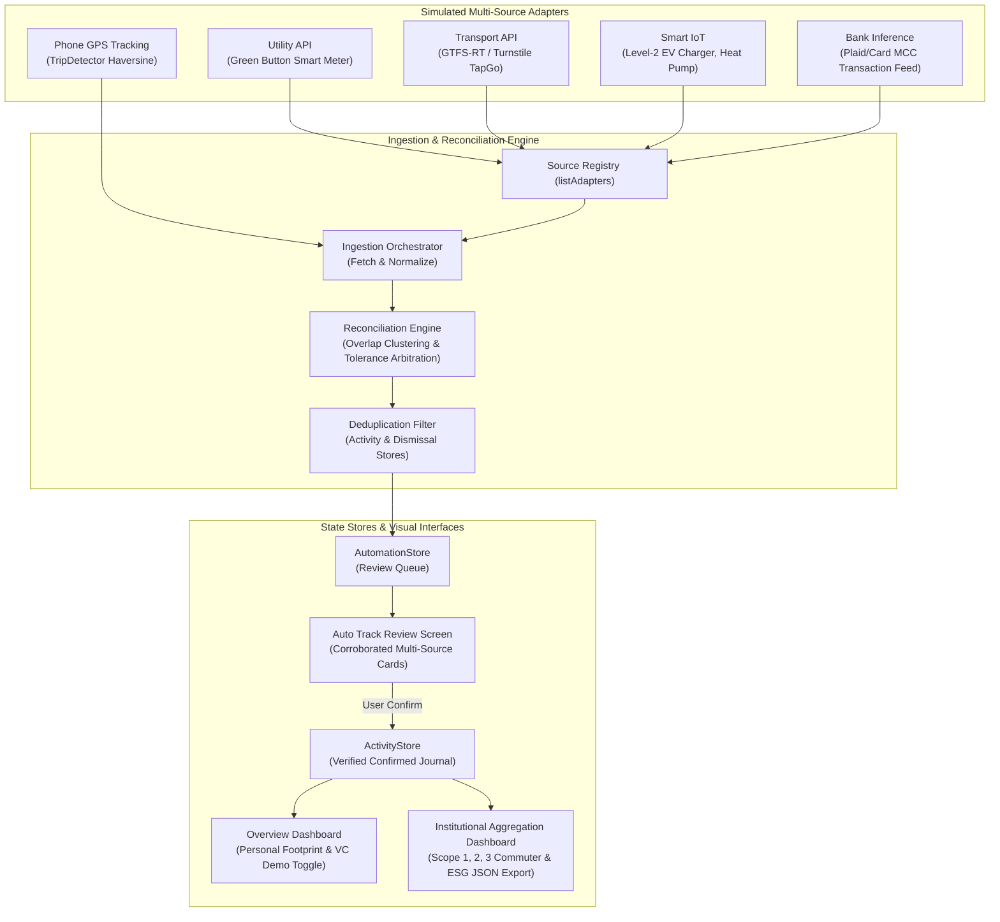

# Project Verdi: Multi-Source Tracking, Reconciliation & Institutional Dashboard

## Executive Summary
This release completes the Phase 2 VC-readiness milestones for **Project Verdi**, transforming the application from single-channel on-device tracking into an enterprise-grade automated carbon accounting and institutional reporting platform.

---

## Architecture Overview



### 1. Multi-Source Ingestion Subsystem (`lib/services/multi_source/`)
- **`MultiSourceAdapter`**: Abstract base contract for all third-party and on-device data adapters, defining `sourceId`, `displayName`, `sourceType`, `TrackingFront`, `baseFidelity`, and `fetchCandidates({DateTime? since})`.
- **`UtilityApiAdapter`**: Simulates Green Button Connect REST endpoints, streaming revenue-grade residential electricity readings (`14.8 – 21.0 kWh/day`, fidelity: `0.98`) with meter IDs and time-of-use tariff rate metadata.
- **`TransportApiAdapter`**: Simulates contactless faregate / smartcard transit APIs (e.g. Cascadia Regional Transit / ORCA), returning station-to-station turnstile-verified journeys (`14.2 km` commuter rail, `6.5 km` bus, fidelity: `0.95`).
- **`SmartIotAdapter`**: Simulates smart home CT-clamp energy monitors, returning Level-2 EV charging sessions (`28.5 – 32.1 kWh`) and heat pump cycles (fidelity: `0.92`).
- **`BankInferenceAdapter`**: Simulates open-banking financial aggregation feeds (MCC `4111` transit fares, MCC `4121` rideshare, MCC `4511` flights, and MCC `5541` fuel dispensers, fidelity: `0.70 – 0.82`).
- **`MultiSourceRegistry`**: Central manager providing `listAdapters()`, registration, unregistration, and source lookup.
- **`IngestionOrchestrator`**: Unified orchestrator coordinating adapter polling, normalization, multi-sensor reconciliation, deduplication against existing activities and dismissed records, and queuing candidates into `AutomationStore`.

### 2. Reconciliation Engine (`lib/services/multi_source/reconciliation_engine.dart`)
- **Spatial-Temporal Clustering**: Detects overlapping activity windows within configurable time tolerances (default: 30 minutes) and domain compatibility (Travel vs. Home/Electricity).
- **Tolerance Arbitration**: Assesses quantity agreement across sources using relative tolerance thresholds (default: 25%) and absolute distance bounds (default: 1.8 km).
- **Travel Mode Disambiguation**: Resolves unlabelled sensor candidates (e.g., phone GPS journeys where travel mode cannot be determined by speed alone) into verified modes (`train`, `bus`, `car`) when corroborated by transit APIs or bank receipts.
- **Accuracy Prioritization & Averaging**:
  - `chosen_most_accurate`: Selects the authoritative hardware/API measurement (e.g., turnstile-verified track distance over GPS wander).
  - `averaged_within_tolerance`: Computes fidelity-weighted averages when sources exhibit comparable precision.
  - `conflict_prioritized`: Flags significant discrepancies for audit review while prioritizing verified hardware telemetry.
- **Corroboration Confidence Boost**: Computes joint reliability $1 - \prod(1 - C_i)$, boosting candidate confidence up to `99%`.

### 3. Institutional Aggregation Dashboard (`lib/features/institutional_dashboard.dart`)
- **Multi-Organization View**: Interactive selector between pre-seeded demo organizations:
  - **Cascadia University**: Higher Education, 1,420 members, 111.0 tonnes CO₂e footprint, Campus Net-Zero by 2030.
  - **Acme CleanTech Corp**: Enterprise Technology, 350 members, 44.0 tonnes CO₂e footprint, 100% Renewable by 2028.
  - **Pacific Northwest Health**: Healthcare System, 820 members, 105.0 tonnes CO₂e footprint, Climate Pledge 2030.
- **Scope 1, 2 & 3 Commuter Roll-Up**: Real-time breakdown across Travel, Home & Facilities, Products, and Waste with progress distributions.
- **Department Leaderboard**: Highlights top departmental contributors, leadership contacts, member counts, emissions, and reduction achievements.
- **Month-over-Month Trend**: 6-month historical trajectory showing verified emission reductions since June 2026.
- **Download Report JSON Export**: Generates GHG Protocol audit-compliant JSON export with instant one-click clipboard copying and dialog inspection.

### 4. VC Demo Mode
- **Instant UI Toggle**: Prominently featured on the Overview Dashboard and AppBar.
- **Complete Product Story**: With one tap, populates both confirmed multi-category journal activities and pending review candidates from all 4 adapters and the reconciliation engine.
- **Zero Real Accounts Required**: Allows investors and reviewers to evaluate the full automated ingestion, reconciliation, and institutional workflow in seconds.

---

## Demo Instructions

### Web Demo
1. Run the local web server:
   ```bash
   flutter run -d chrome
   # Or serve the production build:
   cd build/web && python -m http.server 8080
   ```
2. Navigate to `http://localhost:8080`.
3. In the **Overview** tab:
   - Notice the **VC Demo Mode** switch card. Toggle it **ON**.
   - See the personal carbon footprint update with multi-source confirmed activities (`114.7 kg CO₂e`).
   - Click **Open Institutional Dashboard** (or click the institutional icon in the top AppBar) to explore Cascadia University, Acme CleanTech, and Pacific Northwest Health profiles.
   - Click **Download Report (JSON Export)** to view or copy the audit-ready ESG report.
4. Navigate to the **Auto track** tab:
   - Observe the **Multi-source ingestion** card reporting `4 Adapters Active`.
   - Inspect the candidate review queue containing candidates from Utility API, Transport API, Smart IoT, and Bank card feeds.
   - Note the **Multi-Source Reconciled** badge on the 14.2 km rail commute, displaying cross-verification between Public Transit API, Phone GPS, and Bank Card with `99% confidence`.
   - Click **Confirm activity** to enter a candidate into the journal.
5. In the **Overview** tab, toggle **VC Demo Mode** OFF to return to a clean baseline.

---

## Test & Validation Results

### 1. Static Analysis (`flutter analyze`)
```bash
flutter analyze
```
**Result**: `No issues found! (ran in 8.2s)` — Clean static analysis with 0 errors, 0 warnings, 0 lints.

### 2. Automated Test Suite (`flutter test`)
```bash
flutter test
```
**Result**: `All tests passed!` across all 5 test suites:
- `test/automation_test.dart`: Trip detection, utility CSV parsing, deduplication, and journal confirmation.
- `test/carbon_test.dart`: EPA emission factor calculations, date windows, persistence, and error handling.
- `test/widget_test.dart`: Core navigation, activity creation, deletion, travel comparisons, and responsiveness.
- `test/multi_source_test.dart`: Unit tests for `UtilityApiAdapter`, `TransportApiAdapter`, `SmartIotAdapter`, `BankInferenceAdapter`, `MultiSourceRegistry`, `ReconciliationEngine` (clustering, tolerance arbitration, averaging, mode disambiguation), and `IngestionOrchestrator`.
- `test/institutional_dashboard_test.dart`: Unit tests for member aggregations, per-capita emissions, category roll-ups, JSON report schema generation, and widget tests for organization switching and report downloading.

### 3. Production Web Build (`flutter build web`)
```bash
flutter build web
```
**Result**: `√ Built build\web` — Fully compiles for web with optimized tree-shaken assets.
